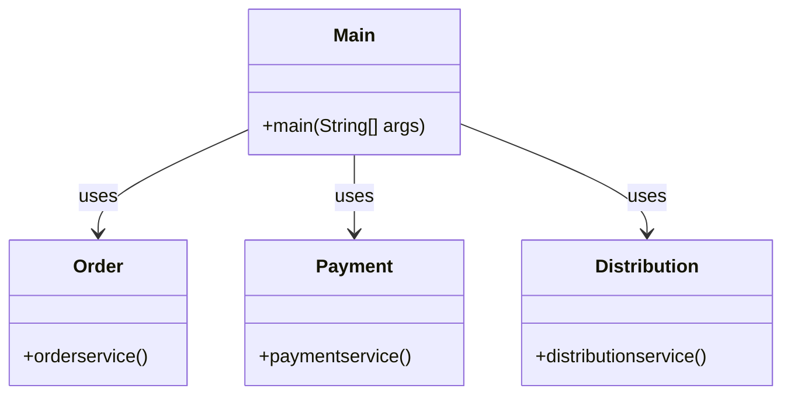
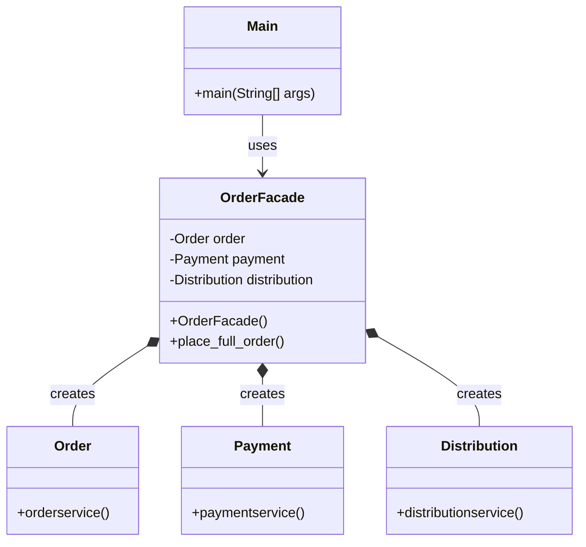
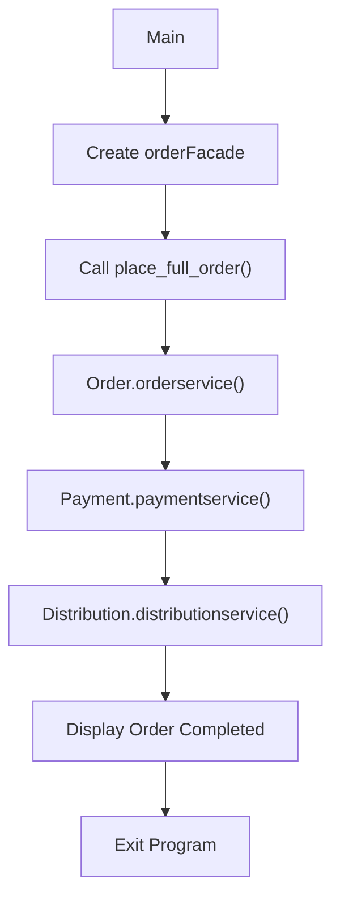

## Facade Pattern – Definition

**Facade Pattern provides a simplified interface to interact with multiple subsystem classes by hiding their internal complexity.**

## Problem – Without Facade

Imagine an order processing system where placing a complete order requires three operations:

- Order placement.
- Payment processing.
- Product distribution and shipping.

Without Facade, the client (`Main`) must create and communicate with all three subsystem classes individually.

### UML Diagram – Without Facade



**Problem:**
- The client directly communicates with multiple classes.
- The client is responsible for coordinating the complete order workflow.
- If the workflow changes, the client may require modifications.
- The client becomes tightly coupled to the subsystem classes.

## Solution – With Facade

We introduce an `OrderFacade` class.

This class internally creates and coordinates the `Order`, `Payment`, and `Distribution` objects.

Now the client only needs to call one method:

```java
orderfacade_object.place_full_order();
```

### UML Diagram – With Facade



## Complete Java Implementation

```java
class Order {

    void orderservice() {
        System.out.println("order placed !!!");
    }
}

class Payment {

    void paymentservice() {
        System.out.println("payment placed !!!");
    }
}

class Distribution {

    void distributionservice() {
        System.out.println("Distribution-shipping is placed !!!");
    }
}

class orderFacade {

    private Order order;
    private Payment payment;
    private Distribution distribution;

    orderFacade() {

        order = new Order();
        payment = new Payment();
        distribution = new Distribution();
    }

    void place_full_order() {

        order.orderservice();

        payment.paymentservice();

        distribution.distributionservice();

        System.out.println(
            "------Your full order is placed via FACADE---------"
        );
    }
}

public class Main {

    public static void main(String[] args) {

        orderFacade orderfacade_object = new orderFacade();

        orderfacade_object.place_full_order();

        System.out.println(
            "------Exiting the Code successfully---------"
        );
    }
}
```

## Execution Flow



## Program Output

```text
order placed !!!
payment placed !!!
Distribution-shipping is placed !!!
------Your full order is placed via FACADE---------
------Exiting the Code successfully---------
```

## Understanding the Difference

| Without Facade | With Facade |
|---|---|
| Main communicates with Order. | Main communicates with orderFacade. |
| Main communicates with Payment. | Facade communicates with Payment. |
| Main communicates with Distribution. | Facade communicates with Distribution. |
| Main coordinates the workflow. | Facade coordinates the workflow. |
| More client-side complexity. | Simpler client-side code. |

## Key Takeaway

Without Facade:

`Main → Order + Payment + Distribution`

With Facade:

`Main → orderFacade → Order + Payment + Distribution`

**The main idea:** Move the responsibility of coordinating multiple subsystem classes into a single Facade class, so the client interacts with one simplified interface.
