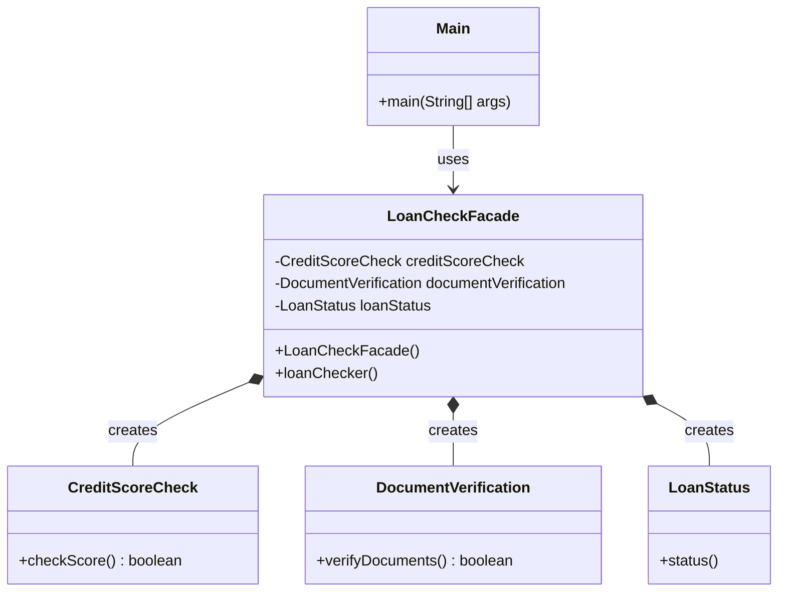

# Facade Design Pattern 

##  What is the Facade Pattern?

The **Facade Design Pattern** is a structural design pattern that provides a simplified interface to interact with a complex subsystem.

In simple words:

Instead of making the client communicate with multiple classes individually, we introduce one class called a **Facade**, which handles communication with those classes.

The client only needs to interact with the Facade.

##  What problem does it solve?

Imagine we have a loan application system.

To approve a loan, we need to perform multiple operations:

1. Check the customer's credit score.
2. Verify the customer's documents.
3. Display the loan approval or rejection status.

Without the Facade Pattern, the client (`Main`) needs to know about all these classes and coordinate their execution.

This creates tight coupling between the client and subsystem classes.

### Without Facade Pattern

```java
CreditScoreCheck credit = new CreditScoreCheck();
DocumentVerification docs = new DocumentVerification();
LoanStatus status = new LoanStatus();

if (credit.checkScore() && docs.verifyDocuments()) {
    status.status();
}
```

**Problem:**
- The client knows about multiple subsystem classes.
- The client is responsible for coordinating their execution.
- If the workflow changes, the client may also need modifications.
- The client becomes tightly coupled to the subsystem.

### With Facade Pattern

```java
LoanCheckFacade loan = new LoanCheckFacade();
loan.loanChecker();
```

Now the client doesn't need to know how the loan verification process works internally.

The Facade handles everything.

##  Class Responsibilities

| Class | Responsibility |
|---|---|
| CreditScoreCheck | Checks the customer's credit score |
| DocumentVerification | Verifies customer documents |
| LoanStatus | Displays approval or rejection |
| LoanCheckFacade | Coordinates all subsystem classes |
| Main | Client that interacts with the Facade |

## Complete Java Implementation

```java
class CreditScoreCheck {

    boolean checkScore() {
        return true;
    }
}

class DocumentVerification {

    boolean verifyDocuments() {
        return true;
    }
}

class LoanStatus {

    void status() {

        System.out.println("---------------------------------");
        System.out.println("Loan Approved");
        System.out.println("---------------------------------");
    }
}

class LoanCheckFacade {

    private CreditScoreCheck creditScoreCheck;
    private DocumentVerification documentVerification;
    private LoanStatus loanStatus;

    public LoanCheckFacade() {

        this.creditScoreCheck = new CreditScoreCheck();
        this.documentVerification = new DocumentVerification();
        this.loanStatus = new LoanStatus();
    }

    void loanChecker() {

        if (this.creditScoreCheck.checkScore()
                && this.documentVerification.verifyDocuments()) {

            this.loanStatus.status();

        } else {

            System.out.println("---------------------------------");
            System.out.println("Loan Rejected");
            System.out.println("---------------------------------");
        }
    }
}

public class Main {

    public static void main(String[] args) {

        LoanCheckFacade loan = new LoanCheckFacade();

        loan.loanChecker();
    }
}
```

##  UML Class Diagram



### Understanding the UML

- `Main` depends on `LoanCheckFacade`.
- `LoanCheckFacade` contains references to three subsystem classes.
- The Facade creates and coordinates these objects.
- `Main` doesn't directly communicate with the subsystem classes.

The filled diamond (`*--`) represents composition in this example because the Facade creates and owns these subsystem instances.


##  Program Output

```text
---------------------------------
Loan Approved
---------------------------------
```

Both verification methods return `true`, so the loan gets approved.

## Real-world Analogy

Think about ordering food through a restaurant waiter.

You don't directly communicate with:

- The kitchen.
- The chef.
- The billing department.
- The inventory department.

You simply tell the waiter what you want.

The waiter coordinates with all these departments.

Here, the waiter acts as a **Facade**.

##  Key Takeaways

- Facade is a structural design pattern.
- It provides a simplified interface to a complex subsystem.
- It hides internal subsystem complexity from the client.
- It reduces coupling between the client and subsystem classes.
- It makes client code cleaner and easier to maintain.
- It doesn't eliminate subsystem classes; it provides a simpler way to interact with them.

### Final Summary

**Facade Pattern = One simplified interface that hides the complexity of multiple subsystem classes.**

In our example:

`Main → LoanCheckFacade → Multiple Subsystem Classes`

The client only interacts with `LoanCheckFacade`. It doesn't need to know how credit checks, document verification, or loan status processing work internally.

### Important Note

Our example uses `new` inside the Facade constructor to create dependencies. This is perfectly fine for understanding the pattern.

In larger applications, Dependency Injection can be introduced to make dependency management more flexible.
